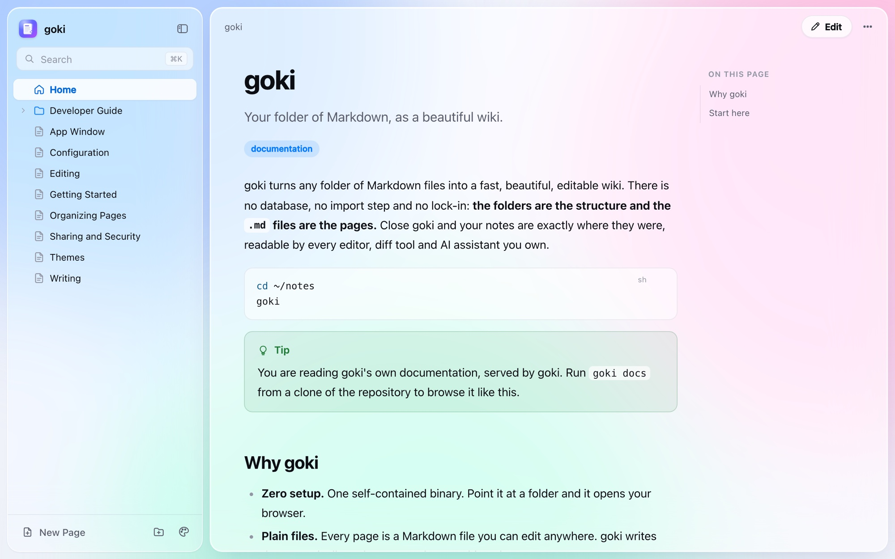
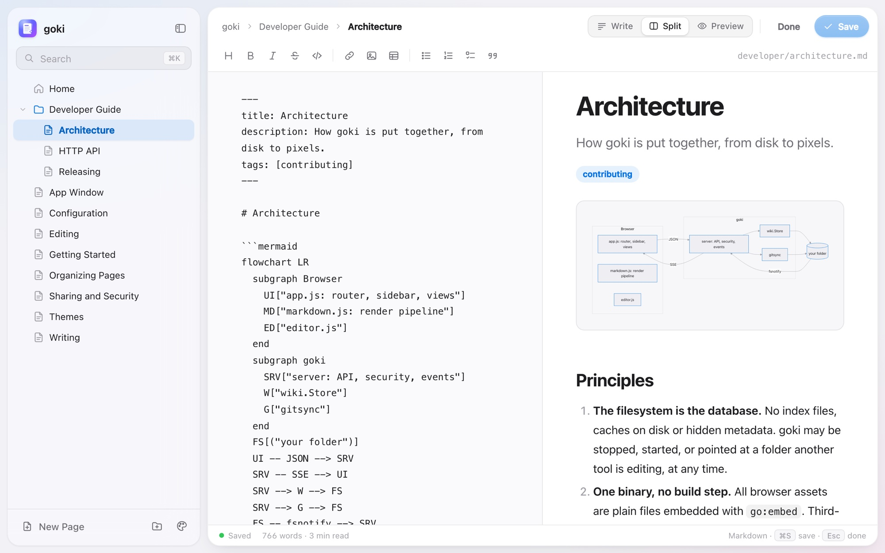
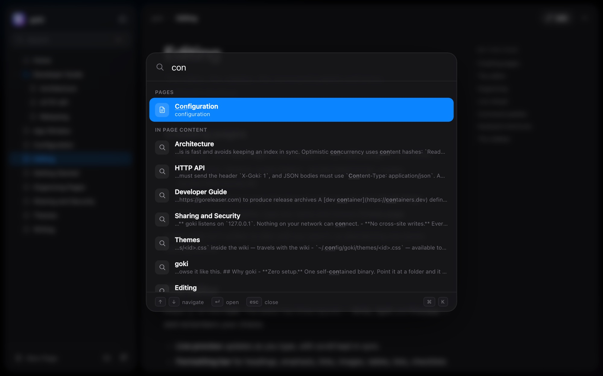
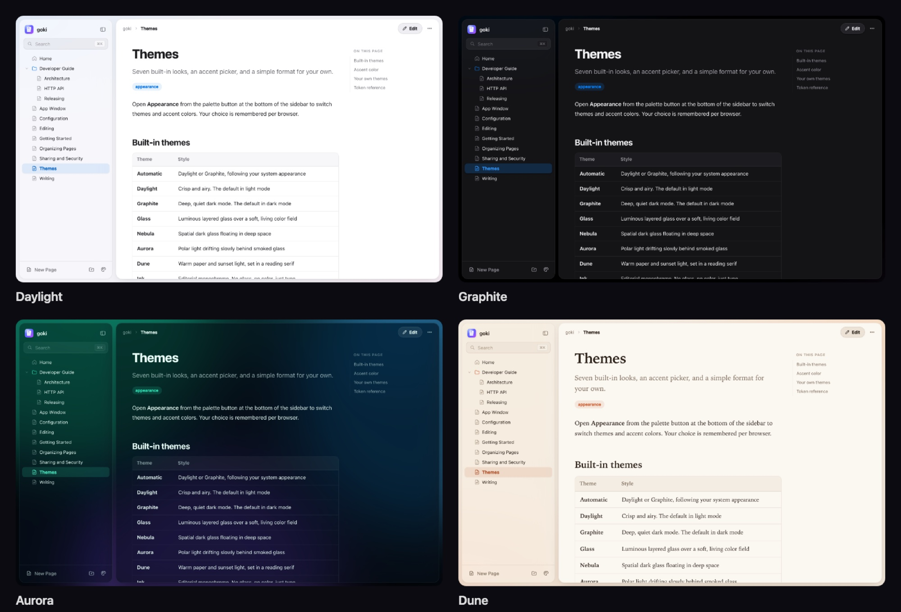
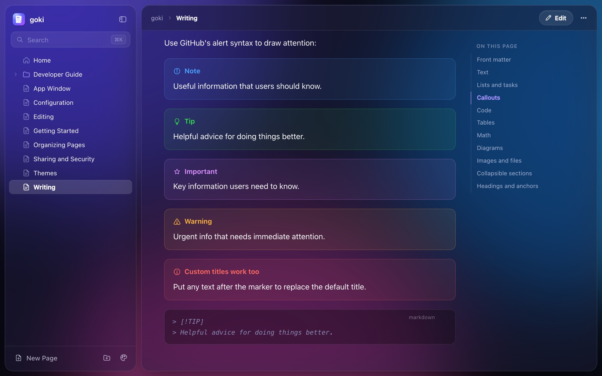

<div align="center">


# goki

**Your folder of Markdown, as a beautiful wiki.**

[](https://github.com/jdtobe/goki/actions/workflows/ci.yml)
[](https://pkg.go.dev/github.com/jdtobe/goki)
[](https://goreportcard.com/report/github.com/jdtobe/goki)
[](LICENSE)

[Getting started](docs/getting-started.md) · [Writing](docs/writing.md) · [Themes](docs/themes.md) · [Configuration](docs/configuration.md) · [Developer guide](docs/developer/index.md)



</div>

```sh
cd ~/notes
goki
```

That's it. goki serves the folder as a wiki, prints the address and opens your browser. **The folders are the structure and the `.md` files are the pages** — no database, no import, no lock-in. Stop goki and your notes are exactly where they were.

## Features

- **Zero setup.** A single, self-contained binary for macOS, Linux, Windows and FreeBSD. Works fully offline.
- **Your files, untouched.** Every page is a plain Markdown file. goki writes atomically and changes nothing else. Edit in goki, your editor or both — open pages update live.
- **A writing experience worth using.** Split editor with live preview, formatting bar, smart lists, image paste and drop, draft recovery and conflict detection.
- **Everything a wiki needs.** Create, rename, move (drag and drop!) and delete pages and folders. Wiki links, full-text search and a ⌘K command palette.
- **Rich Markdown.** GitHub-flavored Markdown with callouts, task lists you can tick, syntax highlighting, KaTeX math, Mermaid diagrams, front matter and an automatic outline.
- **Seven hand-tuned themes**, from crisp *Daylight* to the drifting light of *Aurora* — plus an accent picker and [your own CSS themes](docs/themes.md#your-own-themes).
- **Its own window.** `goki --window` opens the wiki in a dedicated app window — native WebKit on macOS when built with `-tags webview`.
- **Secure by default.** Localhost only, protected against cross-site and DNS-rebinding attacks, confined to its folder, with sanitized rendering under a strict CSP. Optional read-only mode, basic auth and git auto-commit.

<table>
  <tr>
    <td width="50%"></td>
    <td width="50%"></td>
  </tr>
  <tr>
    <td align="center"><sub>Split editor with live preview</sub></td>
    <td align="center"><sub>⌘K to jump anywhere</sub></td>
  </tr>
</table>

## Install

```sh
go install github.com/jdtobe/goki/cmd/goki@latest
```

For the native app window (recommended on macOS), build with cgo and the `webview` tag:

```sh
CGO_ENABLED=1 go install -tags webview github.com/jdtobe/goki/cmd/goki@latest
```

Prebuilt binaries are attached to each [release](https://github.com/jdtobe/goki/releases). There's also a [Dockerfile](Dockerfile) — see [Getting Started](docs/getting-started.md) for every option.

## Usage

```text
goki [flags] [dir]       Serve dir (default ".") as a wiki
goki init [dir]          Create goki.yaml and a welcome page in dir
goki themes              List available themes
goki version             Print the version
```

```sh
goki                         # serve the current folder and open a browser
goki ~/notes --window        # open in a dedicated app window
goki docs -p 8080 -n         # port 8080, don't open anything
goki . --theme aurora        # pick the default theme
goki . --read-only --host 0.0.0.0   # share read-only on your network
goki . --git                 # commit every change to git
```

Every flag has a matching setting in `goki.yaml` and a `GOKI_*` environment variable. See [Configuration](docs/configuration.md).

## How folders become a wiki

```text
notes/
├── index.md                 →  /                    (home page)
├── setup.md                 →  /setup
├── guides/
│   ├── README.md            →  /guides              (section page)
│   ├── 01-install.md        →  /guides/01-install   ("Install")
│   └── assets/diagram.png   →  served as-is, hidden from the sidebar
└── .private/                →  hidden
```

Titles come from front matter, the first `# Heading`, or the file name. Relative links like `[setup](setup.md)` work exactly as on GitHub, and `[[Wiki Links]]` find pages by name. More in [Organizing Pages](docs/organizing-pages.md).

## Themes



Daylight · Graphite · Glass · Nebula · Aurora · Dune · Ink — or **Automatic** to follow your system. Make your own with a few CSS variables: drop `<id>.css` into `.goki/themes/`. See [Themes](docs/themes.md) and the [example theme](examples/themes/solar.css).



## Documentation

The [`docs/`](docs) folder is a goki wiki — clone the repository and run `goki docs` to read it the way it was meant to be read.

| For users | For developers |
| --- | --- |
| [Getting Started](docs/getting-started.md) | [Developer Guide](docs/developer/index.md) |
| [Organizing Pages](docs/organizing-pages.md) | [Architecture](docs/developer/architecture.md) |
| [Writing](docs/writing.md) | [HTTP API](docs/developer/http-api.md) |
| [Editing](docs/editing.md) | [Releasing](docs/developer/releasing.md) |
| [Themes](docs/themes.md) | [Contributing](CONTRIBUTING.md) |
| [Configuration](docs/configuration.md) | [Security Policy](SECURITY.md) |
| [App Window](docs/app-window.md) | [Changelog](CHANGELOG.md) |
| [Sharing and Security](docs/sharing-and-security.md) | |

## Development

```sh
git clone https://github.com/jdtobe/goki.git && cd goki
make run    # serve ./docs; edit anything in web/ and just reload
make test   # go test -race ./...
make lint   # golangci-lint
make help   # all targets
```

The browser app is plain HTML, CSS and ES modules with no build step, embedded into the binary with `go:embed`. Contributions are welcome — please read [CONTRIBUTING.md](CONTRIBUTING.md).

## Acknowledgements

goki stands on the shoulders of [marked](https://marked.js.org), [DOMPurify](https://github.com/cure53/DOMPurify), [highlight.js](https://highlightjs.org), [KaTeX](https://katex.org), [Mermaid](https://mermaid.js.org), the [Inter](https://rsms.me/inter/) typeface, [fsnotify](https://github.com/fsnotify/fsnotify), [pflag](https://github.com/spf13/pflag) and [webview](https://github.com/webview/webview).

## License

[MIT](LICENSE) © Jonathan Tobe
