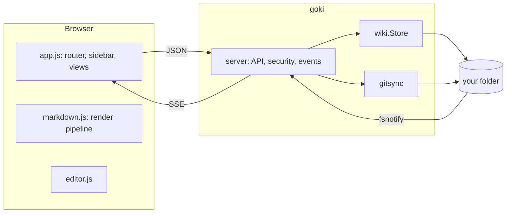

# Architecture

## Principles

1. **The filesystem is the database.** No index files, caches on disk or hidden metadata. goki may be stopped, started, or pointed at a folder another tool is editing, at any time.
2. **One binary, no build step.** All browser assets are plain files embedded with `go:embed`. Third-party libraries are vendored under `web/vendor/`, so goki works fully offline.
3. **Render in the browser.** The server ships raw Markdown; the browser renders it. This keeps the server tiny and lets the editor preview with exactly the same pipeline.
4. **Secure by default.** Every request passes through the same middleware, and every path through `wiki.Store.Clean`.

## Back end

### `internal/wiki`

`Store` owns every filesystem access. `Clean` normalizes user-supplied paths, rejects `..`, NUL bytes and hidden or ignored segments; `abs` additionally resolves symlinks and verifies the result is still inside the root. Writes go to a temporary file in the same directory and are renamed into place, preserving permissions.

`Tree` walks the folder, reading only the first 8 KiB of each page to find its title (cached by modification time). `Resolve` maps a URL route to a page file or folder — a page beats a folder of the same name, and folders resolve to `index.md` or `README.md`. `Search` scans pages on demand; for the wiki sizes goki targets (thousands of pages) this is fast and avoids keeping an index in sync.

Optimistic concurrency uses content hashes: `Read` returns a `Hash`, and `Write` with a `BaseHash` fails with `ErrConflict` if the file changed in the meantime.

### `internal/server`

`Server` wires `net/http`'s pattern router:

- `/-/api/*` — the [[HTTP API]]
- `/-/static/*` — embedded assets, cached immutably when the URL carries `?v=<version>`
- `/-/themes/<id>.css` — custom themes, re-read on every request
- everything else — a real file (image, attachment) if one exists at that path, otherwise the single-page app

`secure` adds security headers, enforces loopback `Host` names when bound to localhost and checks basic auth. `mutating` guards writes with the read-only flag, the `X-Goki: 1` header and an `Origin` check.

`Watch` uses fsnotify to watch every visible folder, debounces bursts for 150 ms and publishes `change` events to the `Hub`, which fans them out to browsers over Server-Sent Events.

### `cmd/goki`

Parses flags with pflag, layers configuration, binds the listener (falling back to a free port), prints the banner and either opens a browser or hands the main thread to the [[App Window]]. Request contexts derive from a cancellable base context so live-reload streams end instantly on shutdown.

## Front end

Plain ES modules in `web/js/`, no framework:

| Module | Responsibility |
| --- | --- |
| `boot.js` | Applies the saved theme before first paint (loaded synchronously) |
| `app.js` | Routing, sidebar tree, page and folder views, dialogs, live updates |
| `markdown.js` | The rendering pipeline and task-list toggling |
| `editor.js` | The source editor, formatting, uploads and drafts |
| `palette.js` | The ⌘K command palette and fuzzy matching |
| `themes.js` | Theme state and the Appearance popover |
| `ui.js` | Element builder, toasts, dialogs, menus, popovers, tooltips |
| `api.js` | The API client and event subscription |
| `icons.js` | The inline SVG icon set |

### Rendering pipeline

1. Split YAML front matter from the body.
2. Parse with [marked](https://marked.js.org) (GFM) plus extensions for wiki links and math.
3. Sanitize with [DOMPurify](https://github.com/cure53/DOMPurify).
4. Enhance the DOM: heading anchors, link resolution (relative `.md` links and wiki links become routes; missing targets are marked), callouts, task lists, tables, highlighted code with copy buttons.
5. Asynchronously, and only when needed, load [KaTeX](https://katex.org) for math and [Mermaid](https://mermaid.js.org) for diagrams.

### Styling

`themes.css` defines design tokens per theme on `[data-theme="<id>"]`. Because the selector isn't tied to `:root`, any element can render in any theme — the Appearance popover uses this to draw live previews. `app.css` styles the chrome and `content.css` the rendered Markdown, both exclusively through tokens.

### Vendored libraries

| Library | Version | Used for |
| --- | --- | --- |
| marked | 15.0.7 | Markdown parsing |
| DOMPurify | 3.2.4 | HTML sanitizing |
| highlight.js | 11.11.1 | Syntax highlighting |
| KaTeX | 0.16.21 | Math (lazy-loaded) |
| Mermaid | 11.4.1 | Diagrams (lazy-loaded) |
| Inter | 4.x | UI font where SF Pro isn't available |

`make vendor` re-downloads them; bump the versions in the `Makefile`. License details are in `web/vendor/THIRD_PARTY_NOTICES.md`.

## Go dependencies

goki deliberately keeps its dependency list short:

| Module | Used for |
| --- | --- |
| `github.com/spf13/pflag` | GNU-style flags that may follow the directory argument |
| `go.yaml.in/yaml/v3` | Config files |
| `github.com/fsnotify/fsnotify` | Live reload |
| `github.com/webview/webview_go` | The native window (only with `-tags webview`) |

The minimum Go version is 1.24, which is checked with the `go1.24.0` toolchain.
