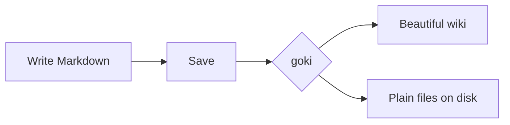

# Writing

goki renders [GitHub-flavored Markdown](https://github.github.com/gfm/) in your browser, then adds a few extras. Everything is sanitized before display, so pages can never run scripts.

## Front matter

Optional YAML at the very top of a page sets its title, a lede and tags:

```yaml
---
title: Release Checklist
description: What we do before every launch.
tags: [process, releases]
---
```

## Text

**Bold**, _italic_, ~~strikethrough~~, `inline code`, <kbd>⌘</kbd> <kbd>K</kbd> keys, <mark>highlights</mark>, and footnote-style superscripts<sup>1</sup> all work as you'd expect.

## Lists and tasks

- Bulleted lists
  - nest with two spaces
1. Numbered lists
2. continue automatically in the editor

- [x] Task lists render as checkboxes
- [ ] Click a checkbox to tick it — goki saves the file for you

## Callouts

Use GitHub's alert syntax to draw attention:

> [!NOTE]
> Useful information that users should know.

> [!TIP]
> Helpful advice for doing things better.

> [!IMPORTANT]
> Key information users need to know.

> [!WARNING]
> Urgent info that needs immediate attention.

> [!CAUTION] Custom titles work too
> Put any text after the marker to replace the default title.

```markdown
> [!TIP]
> Helpful advice for doing things better.
```

## Code

Fenced code blocks are syntax highlighted and gain a copy button:

```go
func main() {
	fmt.Println("Hello from goki")
}
```

## Tables

| Feature | Syntax | Notes |
| :-- | :-: | --: |
| Alignment | `:--` `:-:` `--:` | left, center, right |
| Inline formatting | `**bold**` | works in cells |

## Math

Inline math goes between single dollars, $e^{i\pi} + 1 = 0$, and display math between doubles:

$$
\int_{-\infty}^{\infty} e^{-x^2}\,dx = \sqrt{\pi}
$$

A fenced block with the language `math` works too. Math is rendered by [KaTeX](https://katex.org), loaded only on pages that use it.

## Diagrams

Fenced `mermaid` blocks become diagrams that follow your theme:



## Images and files

Reference images relative to the page, as on GitHub:

```markdown

```

In the editor you can also paste or drag images and files straight in. goki stores them in an `assets/` folder next to the page and inserts the link for you.

## Collapsible sections

<details>
<summary>Click to expand</summary>

Standard HTML `<details>` blocks work, including Markdown inside them.

</details>

## Headings and anchors

Every heading gets an anchor. Hover a heading and click `#` to link to it, or link across pages with `[[Writing#Math]]` or `writing.md#math`. Pages with several sections show an **On this page** outline on wide screens.
